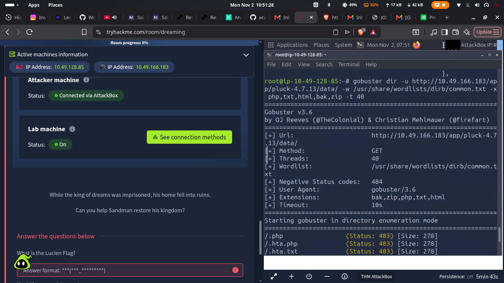
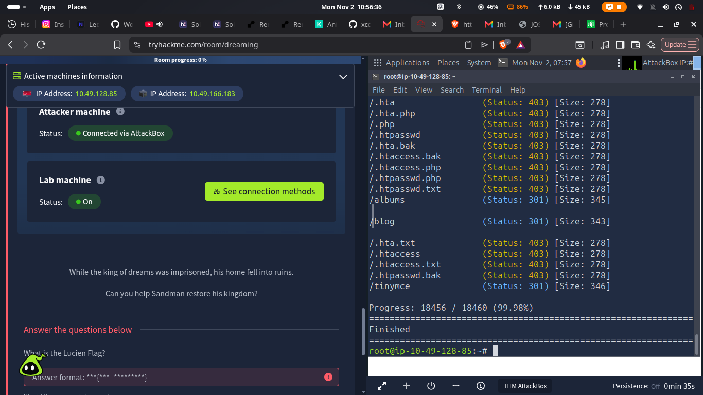
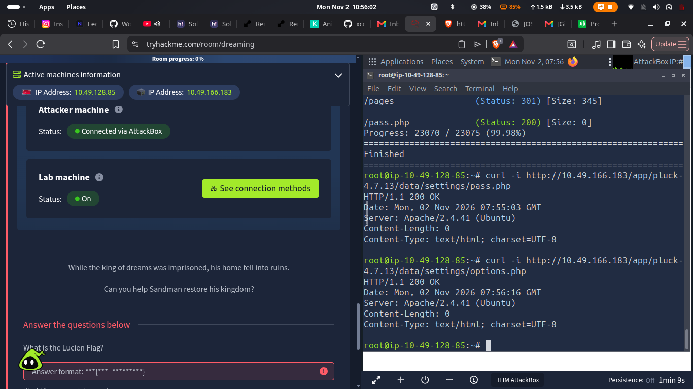

# TryHackMe Dreaming — Web Reconnaissance Write-up

> **Status:** Work in progress. This repository records only the checks completed in the authorized TryHackMe Dreaming laboratory session before the machine expired.

## Scope and authorization

All activity documented here was performed against an ephemeral, assigned TryHackMe lab target. The target address recorded in the screenshots (`10.49.166.183`) is no longer active and must not be treated as a reusable target. Do not use these techniques against systems without explicit authorization.

## Repository contents

```text
.
├── README.md
├── notes/
│   └── findings-tracker.md
└── screenshots/
    ├── README.md
    └── *.png
```

## Objective

Document the completed web reconnaissance of the Dreaming lab in a clear, reproducible way, without claiming exploitation, privilege escalation, or flag recovery that did not occur during the recorded session.

## Environment observed

| Item | Observation |
| --- | --- |
| Platform | TryHackMe Dreaming lab |
| Recorded target | `10.49.166.183` (expired; historical only) |
| Application path | `/app/pluck-4.7.13/` |
| Identified software | Pluck CMS 4.7.13 |

## Step-by-step reconnaissance

### 1. Directory and file enumeration

The application path was enumerated with Gobuster using common directory names and the `php`, `txt`, and `html` extensions:

```bash
gobuster dir -u http://10.49.166.183/app/pluck-4.7.13/ \
  -w /usr/share/wordlists/dirb/common.txt \
  -x php,txt,html -t 40
```

The scan returned several application endpoints and directories, including `/admin.php`, `/login.php`, `/install.php`, `/data/`, `/docs/`, `/files/`, and `/images/`.





### 2. CMS identification and application review

The administration and login pages identified the software as **Pluck 4.7.13**. The administration page redirected unauthenticated visitors to the login page, which presented a password field. The installation page also responded successfully.

The standard Pluck documentation was accessible through `/docs/`; its README confirmed the CMS identity and described the application as a PHP-based content management system.

### 3. Configuration-path checks

Further enumeration focused on the `/data/` area and its `settings`, `modules`, `themes`, `trash`, and `inc` paths. Requests to `data/settings/options.php` and `data/settings/pass.php` returned HTTP 200 but no response body. This was recorded as an observation only—an HTTP success response without content does not establish that a configuration value or credential was exposed.



## Verified findings

| ID | Finding | Evidence |
| --- | --- | --- |
| F-01 | Pluck CMS 4.7.13 identified | Page titles, administration output, and documentation |
| F-02 | Administrative and installation endpoints were reachable | `/admin.php`, `/login.php`, and `/install.php` returned HTTP 200 |
| F-03 | Directory enumeration identified data, documentation, file, and image paths | Gobuster scan output |
| F-04 | The `/docs/` directory permitted listing of standard Pluck documentation | Directory listing captured during the session |
| F-05 | `robots.txt` disallowed `/data/` | Direct `robots.txt` response |
| F-06 | Settings-file URLs returned no visible body in the tested session | Direct `curl -i` responses |

Full evidence and assessment status are in [notes/findings-tracker.md](notes/findings-tracker.md).

## Screenshots

The `screenshots/` directory contains the available raw lab captures recovered from the session. The screenshots have been retained as evidence; they show the historic, now-expired lab IP. See [screenshots/README.md](screenshots/README.md) for the file list.

## Suggested continuation

1. Start a new Dreaming lab machine and record its newly assigned IP separately.
2. Repeat the basic enumeration against the new authorized target.
3. Compare the results with this write-up rather than assuming old paths or responses persist.
4. Add only verified exploitation results and flag evidence to a later update.

## Disclaimer

This repository is for educational documentation of an authorized TryHackMe lab. It is intentionally limited to the reconnaissance carried out during the recorded session.
